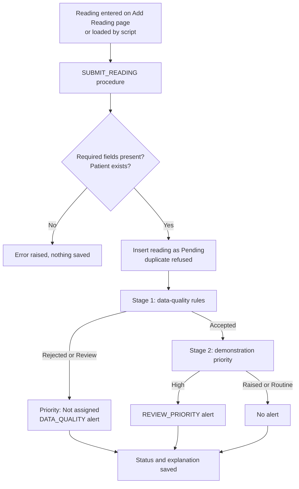
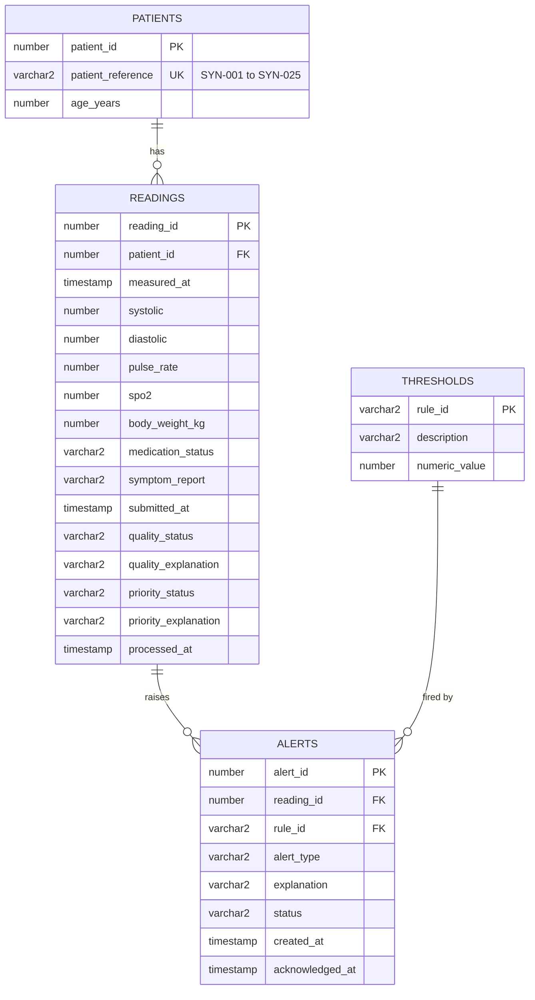
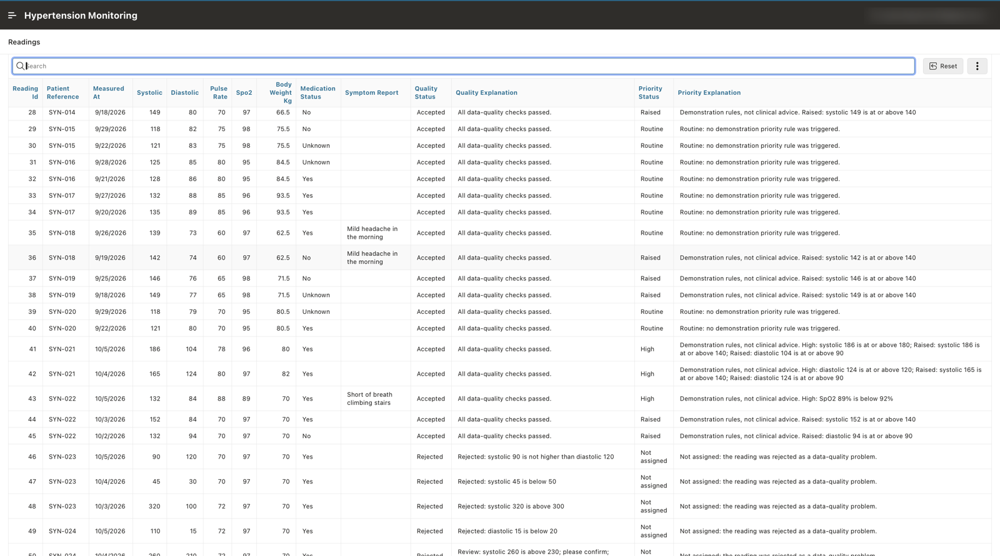
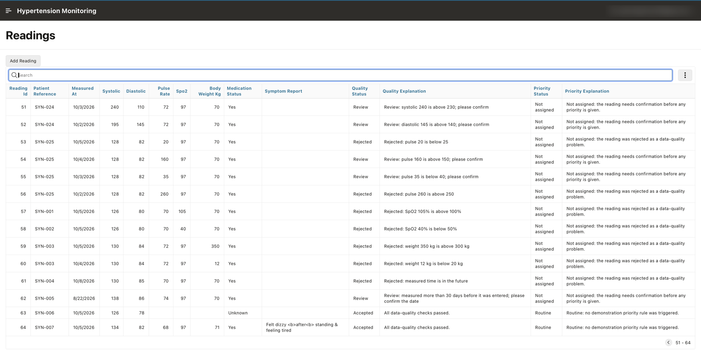
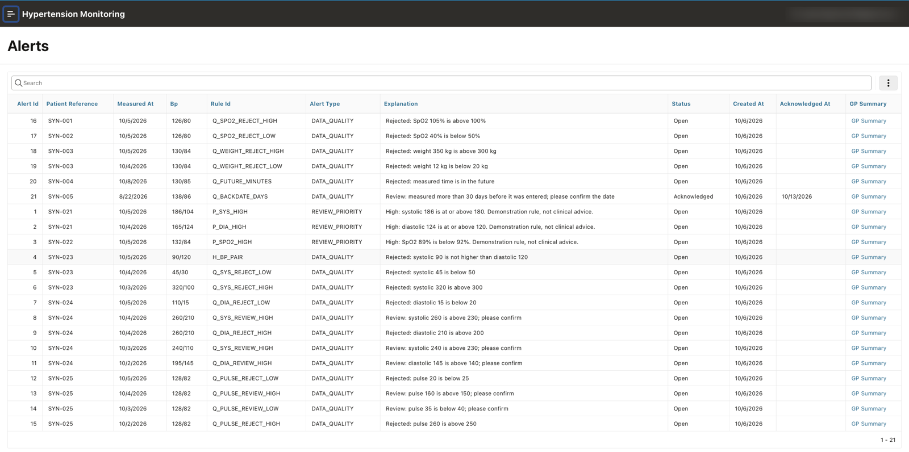
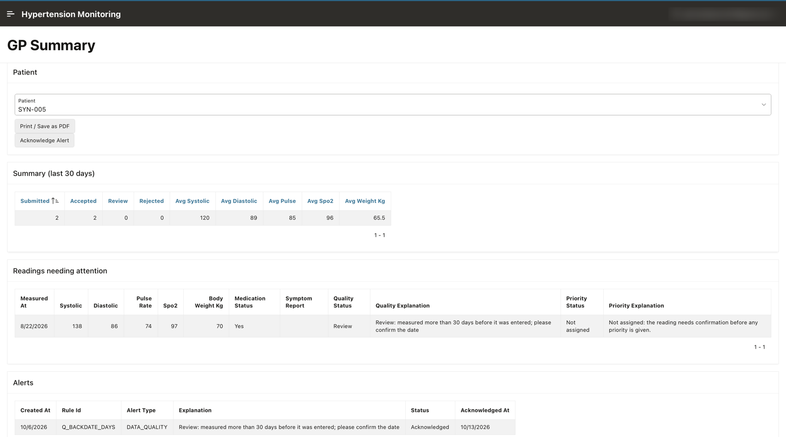
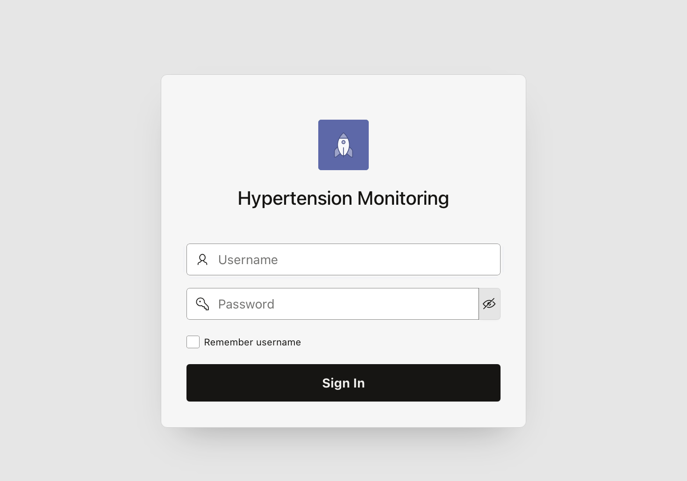

# Hypertension Monitoring Dashboard (Oracle APEX)

A synthetic-data prototype that checks home blood pressure readings, keeps data-quality problems separate from a demonstration review priority, raises alerts, and produces a printable summary designed to support GP review.

Built with Oracle APEX 26.2, Oracle Database, SQL and PL/SQL as an MSc project of Shruthi Reddy Sammi Reddy, Aston University, London.

> **Not for clinical use.** This is an academic demonstration. It uses synthetic data only, its thresholds are not clinically validated, and it does not diagnose, recommend treatment or identify emergencies. It is not a medical device and is not connected to any NHS or GP system.

---

## Contents

- [Why this project](#why-this-project)
- [Features](#features)
- [How it works](#how-it-works)
- [Data model](#data-model)
- [Repository structure](#repository-structure)
- [Setup](#setup)
- [Testing](#testing)
- [Screenshots](#screenshots)
- [Results](#results)
- [Limitations](#limitations)
- [Future work](#future-work)
- [Licence](#licence)

---

## Why this project

Home blood pressure monitoring is widely used in UK primary care, but readings typed in by patients can be missing, duplicated, swapped or simply implausible. A plain list of values does not show which readings can be trusted and which need attention.

This prototype explores a small, transparent rule-based layer that sits between patient-entered readings and the clinician. It is a design exploration using synthetic data, not a finished product.

## Features

- **Two-stage checking.** Every reading is first classified for data quality (Accepted, Review or Rejected). Only Accepted readings then receive a demonstration priority (Routine, Raised or High).
- **Rules as data.** All 22 limits live in a `THRESHOLDS` table, so a limit can be changed with one `UPDATE` instead of a code change.
- **Plain-language explanations.** Every status is stored with a sentence explaining why, such as `Rejected: systolic 90 is not higher than diastolic 120`.
- **Alerts.** Data-quality problems and High-priority readings create alerts, at most one per rule per reading.
- **GP Summary page.** A 30-day summary with averages from Accepted readings only, a list of readings needing attention, and buttons to acknowledge an alert and print or save the page as a PDF.
- **Database-enforced integrity.** Constraints block duplicates and invalid statuses, and make it impossible to store a priority on a reading that did not pass the quality checks.

## How it works



Rejected always overrides Review. If one reading breaks a Reject rule and a Review rule, it is Rejected and both findings appear in the explanation.

The procedure is called explicitly. It is not a trigger, so a row inserted directly into `READINGS` skips the rules. This is a known limitation (see [Limitations](#limitations)).

## Data model



### Rules

| Group | Count | Examples |
|---|---|---|
| Fixed logic | 1 | `H_BP_PAIR`: rejected if systolic is not higher than diastolic |
| Data quality: Reject | 11 | `Q_SYS_REJECT_HIGH` (300), `Q_SPO2_REJECT_HIGH` (100), `Q_FUTURE_MINUTES` (5) |
| Data quality: Review | 5 | `Q_SYS_REVIEW_HIGH` (230), `Q_PULSE_REVIEW_LOW` (40), `Q_BACKDATE_DAYS` (30) |
| Demonstration priority | 5 | `P_SYS_HIGH` (180), `P_SPO2_HIGH` (below 92), `P_SYS_RAISED` (140) |

The full list is in [`sql/01_thresholds.sql`](sql/01_thresholds.sql). **All values are demonstration values chosen to exercise the software.**

## Repository structure

```
hypertension-apex-dashboard/
├── README.md
├── LICENSE
├── sql/
│   ├── 00_tables.sql           # four tables and all constraints
│   ├── 01_thresholds.sql       # 22 rules
│   ├── 02_patients.sql         # 25 synthetic patients
│   ├── 03_submit_reading.sql   # SUBMIT_READING procedure
│   ├── 04_sample_readings.sql  # 64 synthetic readings incl. edge cases E01–E25
│   └── 05_check_results.sql    # queries comparing results with expected values
├── apex/
│   ├── f54570.sql              # APEX application export (all 10 pages)
│   └── README.md               # how to import it
└── docs/
    └── screenshots/
```

## Setup

You need an Oracle APEX workspace. A free workspace at [oracleapex.com](https://oracleapex.com) is enough.

### 1. Database

In **SQL Workshop → SQL Scripts**, upload and run the scripts **in this order**:

| Order | Script | Expected result |
|---|---|---|
| 1 | `00_tables.sql` | 4 tables created |
| 2 | `01_thresholds.sql` | 22 rows |
| 3 | `02_patients.sql` | 25 rows |
| 4 | `03_submit_reading.sql` | procedure created |
| 5 | `04_sample_readings.sql` | 64 readings, 21 alerts, 1 duplicate refused |
| 6 | `05_check_results.sql` | each query states its expected result |

`04_sample_readings.sql` is designed to run once. Its dates are relative to the day you run it, so the future-date and backdated test cases always behave the same way.

### 2. Application

In **App Builder → Import**, import [`apex/f54570.sql`](apex/f54570.sql) and follow the wizard. Full steps are in [`apex/README.md`](apex/README.md).

The export already has **Automatic Time Zone** switched on. This matters: without it, readings entered at the current local time can be rejected as being in the future, because the database may run on a different time zone.

### Pages

| Page | Purpose |
|---|---|
| 1 Home | Landing page |
| 2 Patients | List of synthetic patients |
| 3 Patient | Add or edit a patient |
| 4 Readings | All readings with statuses and explanations |
| 5 Add Reading | Form; its process calls `SUBMIT_READING` |
| 6 Alerts | All alerts, each linking to the GP Summary |
| 7 Rules | Rules currently in `THRESHOLDS` |
| 8 GP Summary | 30-day summary, readings needing attention, acknowledge and print |
| 9999 Login | Standard APEX login |

## Testing

`04_sample_readings.sql` loads 40 baseline readings plus 25 edge cases (E01–E25). Each edge case targets one rule and states its expected result in a comment. E24 is a deliberate duplicate that should be refused.

Expected totals after loading:

| Measure | Expected |
|---|---|
| Readings | 64 |
| Quality status | Accepted 47, Review 5, Rejected 12 |
| Priority status | High 3, Raised 14, Routine 30, Not assigned 17 |
| Alerts | 21 (18 `DATA_QUALITY`, 3 `REVIEW_PRIORITY`) |

Run `05_check_results.sql` to compare.

## Screenshots

**Readings, edge cases E01–E10**


**Readings, edge cases E11–E25**


**Alerts**


**GP Summary**


**Login**


## Results

In the evaluation, all 24 stored edge cases were classified exactly as expected, and the 21 alerts were each raised by the expected rule. In the 62 readings captured in screenshots, quality and priority status matched the specification in every case.

These results show agreement with the developer's own specification. **They are not a measure of clinical accuracy.**

## Limitations

- **Synthetic data only.** Thresholds are unvalidated and there was no clinical review.
- **No role-based access.** Every logged-in user can view and change all data. Login uses Oracle APEX Accounts, which Oracle does not recommend for production.
- **Procedure can be bypassed.** A row inserted directly into `READINGS` skips the rules and stays `Pending`.
- **Missing features.** There is no audit trail and no page for deleting readings.
- **Plausible errors pass.** The rules catch impossible and unusual values, not wrong-but-plausible ones.
- **Not a NICE average.** The summary average does not follow the NICE home blood pressure monitoring protocol.
- **Extreme readings are routed as data checks.** A genuinely very high reading above the Review limit is sent for Review as a possible data error, not given High priority.
- **Display issues.** Dates display in US format, and the summary's Review count can differ from its attention list because of the 30-day window.
- **Limited usability evidence.** Usability was checked only by the developer.

## Future work

- Expert clinical validation of the rules and summary
- User testing with patients and clinicians, with the appropriate ethics approvals
- Secure NHS integration using HL7 FHIR
- Direct ingestion from validated home monitors
- Stronger security: external identity provider, roles, audit trail
- Accessibility testing against WCAG 2.2
- Larger synthetic datasets and performance testing
- A formal usability study

## Licence

Released under the [MIT Licence](LICENSE).
